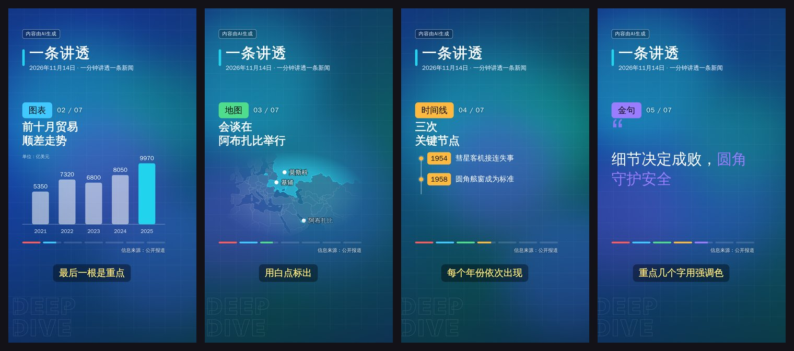

<p align="center"></p>

# 自影 AutoReel

> **English:** AutoReel (自影) is an open-source, fully automated short-video pipeline for Chinese creators: **find a topic → write the script → voice it → render a vertical video → publish**. Any coding agent (Claude Code, Codex, Gemini CLI, Cursor, OpenCode …) does the research and writing via AGENTS.md, on its own scheduler or on GitHub Actions / local cron; voice it with Volcengine Doubao TTS (the same voices used across Douyin/CapCut) or offline CosyVoice, storyboard every segment (royalty-free stock footage from Pexels/Pixabay, animated charts, offline maps, timelines, quote cards or your own assets), render with [HyperFrames](https://github.com/heygen-com/hyperframes), then push to a private GitHub repo. A Chrome extension downloads each clip and publishes it to Douyin (WeChat Channels / Kuaishou optional), with QR-code login, session keep-alive, verification prompts and templated webhooks (WeCom, Feishu, DingTalk, OneBot 11/12, Bark, Telegram …). Channels are plain folders, so you can add your own. Docs are in Chinese.

一条从**找方向 → 写文案 → 配音 → 生成视频 → 发作品**全自动跑完的短视频流水线。每个「频道」就是一个文件夹，定义好主题和规则，每天自动出片、自动发布。

## 内置频道示例

| 频道 | 内容 | 素材来源 |
|---|---|---|
| 热点快报 `kuaibao` | 当天 4–6 条要闻速览 | 新闻搜索 |
| 一条讲透 `jiangtou` | 挑一条新闻讲清来龙去脉 | 新闻搜索 |
| 历史上的今天 `lishi` | 这一天的 3 件大事（提前一天备好） | 百科、史料 |
| 一分钟冷知识 `lengzhishi` | 一个知识点讲明白 | 科普资料（至少 2 个来源印证） |
| 一分钟读本书 `dushu` | 一本书的核心观点 | 你的书单 `inputs/dushu/书单.md` + 书评 |
| 好物推荐 `haowu` | 一件产品的看点 | **只用你提供的资料** `inputs/haowu/` |
| 每天一个成语 `chengyu` | 一个成语的出处、故事、用法 | 成语词典、典籍原文 |

日常管理都可以在**浏览器插件**里做，保存后自动写回仓库：「频道」页改发往哪些账号、发布时间、口号、话题、篇幅、配色、配音语气和语速、写稿规则；「制作设置」改配音引擎、基础语速、可信来源；「发布平台」管理各平台账号；「素材」页编辑书单、上传产品图片；「音色」页试听和录制自己的声音；「作品」页看每期的发布状态和成片。

想做别的主题？在你的 AI 工具里对仓库说一句「**新建一个频道，讲 XX**」，`autoreel-channel` 技能会一步步引导你：调研同类账号和可信来源、定结构和语气、并排比较几套配色、自动校验、试做一期，最后启用并建好定时任务。也可以手动复制一个频道文件夹修改，详见 [docs/新建频道.md](docs/新建频道.md)。

## 工作原理

```
任意 AI 工具的定时任务（每个频道每天一次；Claude Code、Codex、Gemini CLI……或 GitHub Actions / 本机 cron）
  └─ AGENTS.md → autoreel 技能（AI 负责找方向、写稿）
       ① 找方向：按频道 brief 搜索 / 读你的素材，事实需有来源
       ② 写文案 + 分镜：每段配一个画面（实拍 / 图表 / 地图 / 时间线 / 金句 / 你的素材）
       ③ 配音：火山引擎豆包语音或 CosyVoice3，每段按内容换语气，逐句检查清晰度
       ④ 生成视频：按分镜取素材、画图表和地图，HyperFrames 渲染 1080×1920 竖屏，带字幕和「内容由AI生成」标识
       ⑤ 封面与发布信息：竖横双封面、标题、正文、话题、合集、AI 声明
  └─ 推送到你的私有仓库 clip-日期-频道 分支
        └─ Chrome 插件「自影 AutoReel」到点自动发布到抖音（视频号 / 快手可选）
              └─ 结果写回仓库，浏览器通知 / Webhook 告诉你
```

- **不绑定某一家 AI**：AI 只负责找选题和写稿，配音、画面、渲染、推送都是一条命令 `tools/make.py`。用哪家 AI 工具、用它自带的定时任务还是 GitHub Actions，安装向导帮你选。
- **不需要服务器**：生成在 AI 工具的云端（或 GitHub Actions、你自己的电脑），发布在你自己的 Chrome 里，中间用私有 GitHub 仓库当"信箱"。
- **用你自己的浏览器发布**：登录状态是你自己的，插件只操作它自己打开的窗口。
- **多账号**：同一平台的多个账号各用一个 Chrome 用户资料登录，频道可以分别选发往哪些账号；发布前按平台账号 ID 核对，不会发错号。
- **需要你时会叫你**：短信 / 滑块验证、登录失效、发布失败，都会通知你（可推到手机、QQ 群、企业微信群）。

## 画面：不只是文字播报

每一段口播都配一个分镜，AI 按内容自动挑：

| 分镜 | 适合 | 画面 |
|---|---|---|
| 实拍 `footage` | 城市、自然、工业、生活场景 | 按英文关键词从 **Pexels / Pixabay** 取免版权竖屏视频，自动裁切、调速、去原声，文案末尾自动注明来源 |
| 图表 `chart` | 涨跌、对比、排名 | 柱状图 / 折线图，数字逐个长出，重点项高亮 |
| 地图 `map` | 地点、国家、路线 | 离线绘制的区域地图（Natural Earth 数据），自动框选范围、标注地点、高亮国家 |
| 时间线 `timeline` | 来龙去脉、历史节点 | 2–5 个节点依次出现 |
| 金句 `quote` | 原话、结论 | 大字逐字出现，关键字高亮 |
| 你的素材 `asset` | 产品图、实拍 | `inputs/<频道>/` 里的图片或视频 |

图表、地图等画面还能叠一层实拍视频做背景。任何一个分镜出错（素材没搜到、数据有误）都会自动退回文字画面，不会出不了片。实拍素材需要免费的 Pexels / Pixabay 密钥，配置方法见[部署指南](docs/部署指南.md#第-4-步实拍素材可选推荐)。

<p align="center"></p>

## 配音

| 方案 | 音色 | 成本 | 速度（一分钟视频） |
|---|---|---|---|
| **火山引擎豆包语音** `volcengine` | 抖音、剪映同源的大量音色 | 按量付费，需自己开通 | 几秒 |
| **CosyVoice3** `cosyvoice` | 内置女声 / 男声，每段可换语气（轻快、严肃、沉重、悬念…），或用你自己的录音 | 免费，离线 | 无显卡约 5–6 分钟 |
| sherpa 轻量模型 `sherpa` | Kokoro 等 | 免费，离线 | 几秒 |

默认 `auto`：填了火山引擎就用火山引擎，否则用 CosyVoice3。不管用哪种，字幕都按原稿显示数字和日期（配音自动转成读法），逐句合成、按标点控制停顿、标注多音字，并用离线语音识别**逐句检查有没有念清楚**，没念清楚的自动重做。

## 快速开始

完整步骤见 **[docs/部署指南.md](docs/部署指南.md)**：

1. **Use this template → Create a new repository**，**选 Private**。
2. 改 `autoreel.config.json`：启用哪些频道、配音方案。
3. （可选）申请免费的 Pexels / Pixabay 密钥，填进云端环境变量，开启实拍素材。
4. 生成只对这个仓库有 **Contents 读写** 权限的 GitHub 令牌。
5. 在你的 AI 工具里打开仓库，说「帮我设置自影的定时任务」，安装向导会按你的工具建好（也可以手动创建，指令见 [prompts/定时任务.md](prompts/定时任务.md)）。
6. Chrome 加载 `extension/`，填仓库和令牌，扫码登录抖音。

## 更新

上游有更新时，在你的仓库里运行 `python3 tools/sync_upstream.py` 预览、加 `--apply` 同步：框架代码会更新，你的频道、配置和素材不会被覆盖。详见 [docs/同步更新.md](docs/同步更新.md)。

## 使用前请务必了解

- **内容责任在你**。流水线要求每条事实都有可信来源，但 AI 仍可能出错。建议前几周每天看一眼成片和来源（云端会把视频和来源链接发给你）。
- **AI 内容标识**：画面常驻「内容由AI生成」，发布时勾选平台 AI 声明，请勿去掉。
- **商业内容**：好物类频道只使用你提供的资料，推广内容会标注「广告」；请遵守广告法和平台规则。
- **平台规则**：自动化发布可能不符合部分平台的用户协议，存在限流或封号风险，请自行评估。本项目不提供任何绕过平台风控的手段。
- **声音授权**：用 CosyVoice 复刻音色时，只能使用你本人或已获授权的声音。

## 目录

| 路径 | 内容 |
|---|---|
| `channels/<频道>/` | 频道定义：`channel.json`（设置）+ `brief.md`（找方向、写文案的规则） |
| `inputs/` | 需要你提供素材的频道（书单、产品资料） |
| `.claude/skills/autoreel/` | 出片技能（各频道通用）：找方向 → 写文案 → 自查 → 配音 → 生成视频 → 推送 |
| `AGENTS.md` | 给所有 AI 工具的入口说明 |
| `.claude/skills/autoreel-channel/` | 频道管理技能：交互式新建、编辑、停用频道 |
| `.claude/skills/autoreel-setup/` | 安装与定时任务向导：按你的 AI 工具建好定时任务 |
| `schedulers/` | 没有定时任务功能的 AI 工具用：GitHub Actions、本机 cron / launchd 模板 |
| `tools/` | `make.py` 一条命令出片、`notify.py` webhook 通知、`gen_hf.py` 生成视频工程和文案、`scenes.py` 分镜画面、`footage.py` 实拍素材、`mapsvg.mjs` 地图、`tts.py` 配音、`voice_qc.py` 配音清晰度检查、`voices/` 内置音色、`make_cover.py` 封面、`check_channel.py` 频道检查与预览、`palettes.json` 配色预设、`push_clip.sh` 推送、`sync_upstream.py` 同步上游更新、`setup.sh` 安装 |
| `extension/` | Chrome 插件（Manifest V3） |
| `prompts/` | 定时任务指令模板 |

## 名字

本项目原名 AutoClip，为了避免和 GitHub 上同名的视频切片项目混淆，改名为**自影 AutoReel**。

## 许可

[MIT](LICENSE)。第三方组件见 [THIRD_PARTY_NOTICES.md](THIRD_PARTY_NOTICES.md)。
